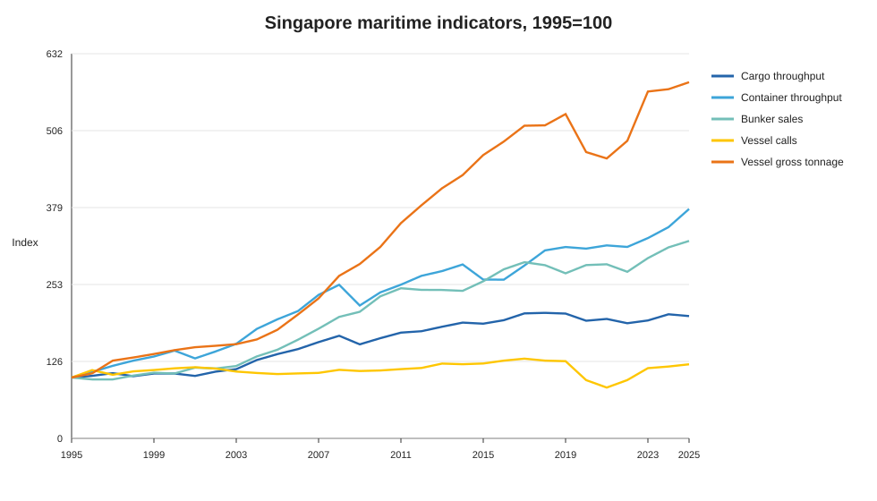
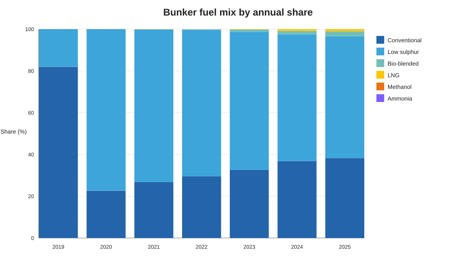
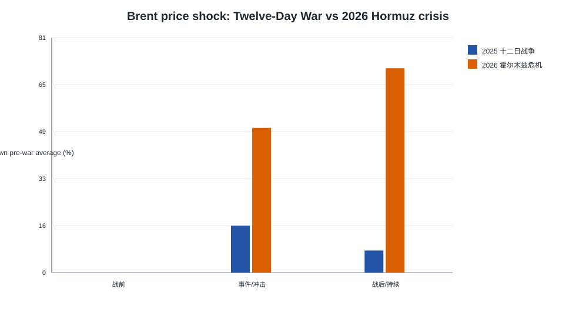
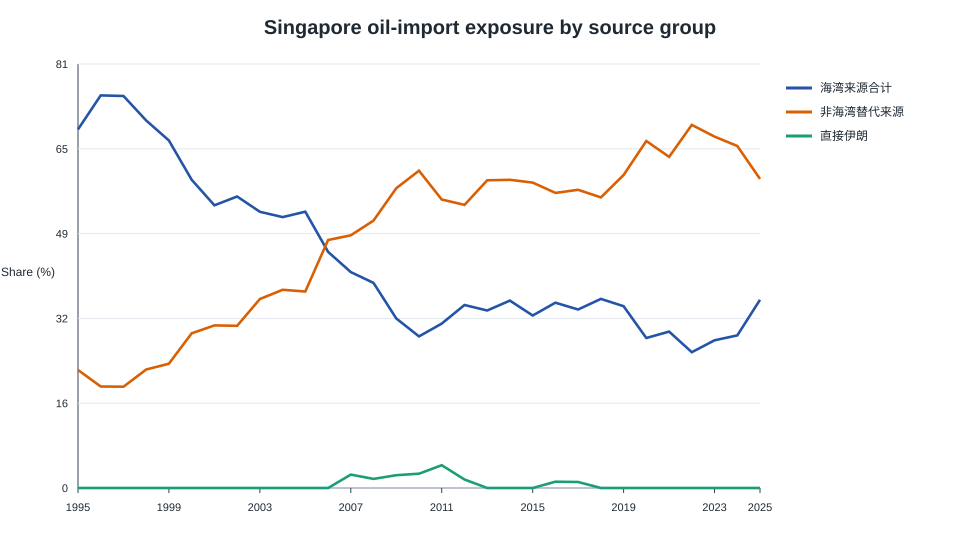
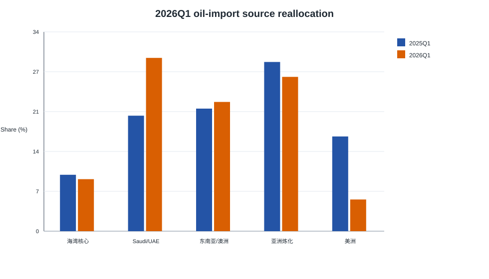

# Singapore Maritime Energy Analytics

This project analyzes Singapore's role as a maritime energy hub using official Singapore port data, oil-import market data, Brent crude prices, and PortWatch-derived regional shipping activity.

The project is built for a resume/GitHub portfolio: it includes reproducible Python scripts, cleaned outputs, SVG charts, written analysis reports, a Streamlit dashboard, and a static HTML project page.

## Project Story

The core finding is that Singapore's long-run port growth is not simply a story of more ships. From 1995 to 2025, vessel calls grew slowly, while vessel gross tonnage, container throughput, and bunker fuel sales grew much faster. Singapore's hub value increasingly comes from serving larger vessels, supplying marine fuel, and absorbing energy-shipping shocks.

The geopolitical extension adds a second story: Iran is not a major direct supplier to Singapore, but it acts as a risk switch for Gulf supply chains. Direct Iran oil-import exposure is near zero after 2019, while indirect Gulf exposure through Saudi Arabia, UAE, Qatar, Kuwait, and Bahrain remains material.

## Key Results

- Cargo throughput roughly doubled from 1995 to 2025.
- Vessel calls rose only 21.8%, but vessel gross tonnage rose 485.5%.
- Bunker fuel sales reached a complete-year peak in 2025.
- The 2025 Twelve-Day War produced a short Brent risk-premium shock.
- The 2026 Hormuz crisis produced a much larger and more persistent Brent shock.
- Singapore's direct Iran oil-import share was effectively zero after 2019.
- Gulf oil-import exposure fell from 68.6% in 1995 to 36.0% in 2025, but rose to 38.8% in 2026Q1.

## Charts











## Repository Structure

```text
analysis/
  run_all.py                         # one-command reproduction entrypoint
  singapore_maritime_energy_story.py # long-run Singapore port analysis
  us_iran_war_impact.py              # 2026 crisis event-window analysis
  compare_twelve_day_vs_2026.py      # 2025 vs 2026 event comparison
  iran_hormuz_exposure_story.py      # Hormuz exposure grouping analysis
  generate_resume_assets.py          # SVG charts and static docs page
  charts/                            # generated SVG charts
  output/                            # reports and processed tables
dashboard/
  app.py                             # Streamlit dashboard
docs/
  index.html                         # static project page
  interactive.html                   # ECharts interactive story page
  assets/                            # SVG copies for GitHub Pages
malacca_strait_data_package/
  malacca_strait_data_package/
    data/official_data_gov_sg/       # official Singapore CSV files
    raw/                             # raw Brent CSV and large workbooks
```

## Reproduce

Install dependencies:

```bash
pip install -r requirements.txt
```

Run all analysis scripts and regenerate reports/charts:

```bash
python analysis/run_all.py
```

Run the dashboard:

```bash
streamlit run dashboard/app.py
```

Open the static project page:

```text
docs/index.html
```

Open the interactive ECharts story page:

```text
docs/interactive.html
```

If using GitHub Pages, set the Pages source to the `docs/` folder. The interactive page uses Apache ECharts from a CDN, so it needs internet access when opened.

## Main Reports

- [Singapore maritime energy story](analysis/output/singapore_maritime_energy_story.md)
- [2026 US-Iran/Hormuz impact](analysis/output/us_iran_war_impact.md)
- [Twelve-Day War vs 2026 Hormuz crisis](analysis/output/twelve_day_vs_2026_comparison.md)
- [Iran/Hormuz exposure story](analysis/output/iran_hormuz_exposure_story.md)

## Data Sources

- Maritime and Port Authority of Singapore via data.gov.sg.
- Enterprise Singapore oil-import market data via data.gov.sg.
- Brent crude oil price series from the local FRED mirror in the data package.
- FetchSeries workbooks derived from IMF PortWatch for regional daily port-call context.
- EIA background on the Strait of Hormuz chokepoint: https://www.eia.gov/todayinenergy/detail.php?id=65504+

See [DATA_DICTIONARY.md](DATA_DICTIONARY.md) for field definitions and coverage.

## Resume Bullets

- Built a reproducible Singapore maritime energy analytics project using official port, bunker fuel, tanker-arrival, oil-import, Brent crude, and regional PortWatch data.
- Cleaned wide-format trade data into analytical panels, constructed Hormuz exposure indicators, and generated event-window comparisons for geopolitical shocks.
- Found that direct Iran oil-import exposure was near zero after 2019, while indirect Gulf exposure remained material at 36.0% in 2025 and rose to 38.8% in 2026Q1.
- Compared the 2025 Twelve-Day War and 2026 Hormuz crisis, showing the latter had a much larger and more persistent Brent price shock.

## GitHub Notes

Large raw Excel workbooks are ignored by default. Before publishing, review [GITHUB_UPLOAD_CHECKLIST.md](GITHUB_UPLOAD_CHECKLIST.md) and decide whether to include full raw data, use Git LFS, or publish only source links plus processed tables.
